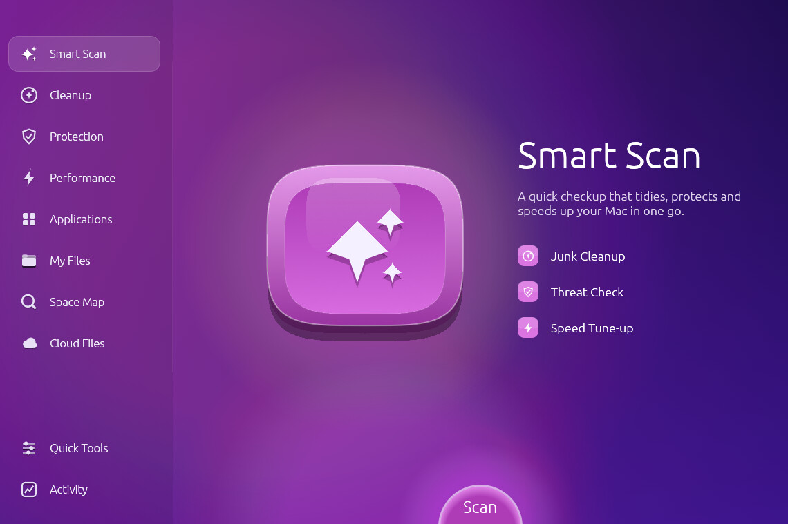
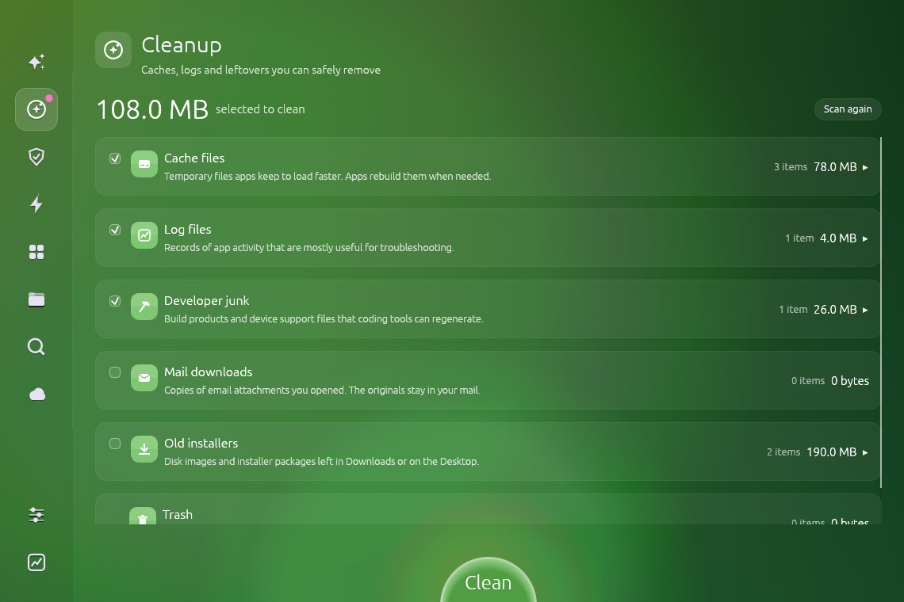
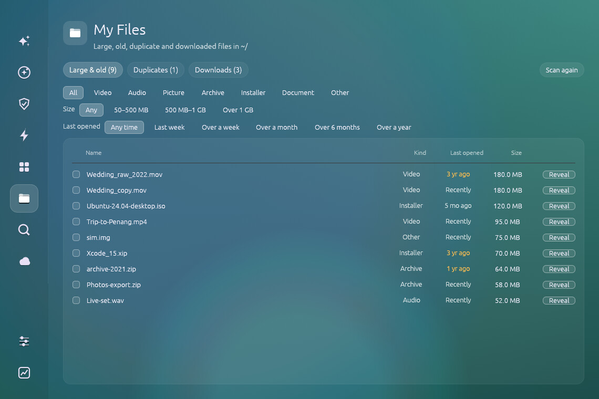
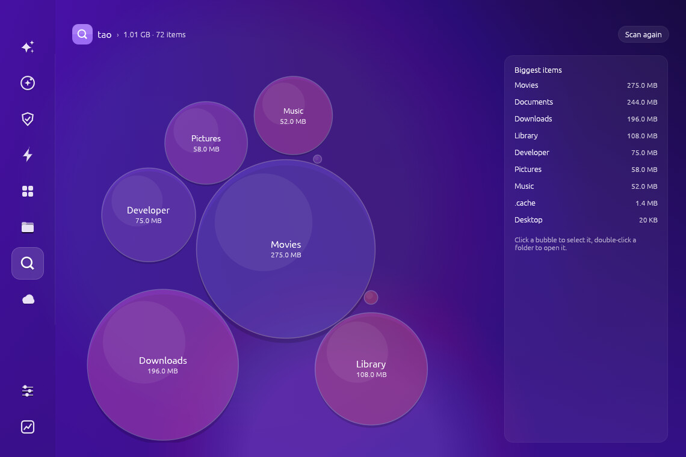
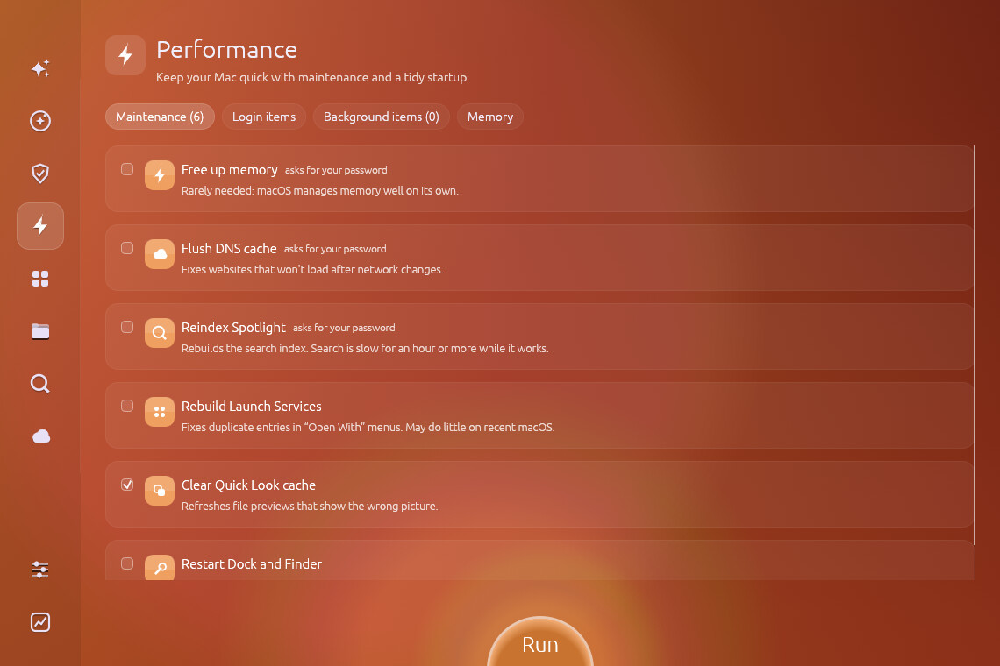
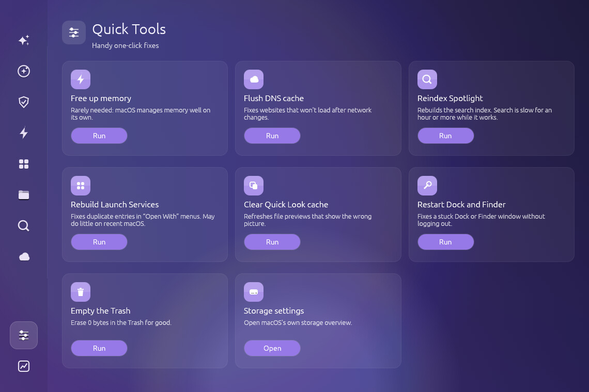

<p align="center">
  
</p>

<h1 align="center">Cleanerio</h1>

<p align="center">
  A Mac cleaner and maintenance app, written in Rust.<br>
  Find junk, large files, duplicates and unused apps, and see what fills your disk.
</p>

<p align="center">
  <a href="https://github.com/TaoMonLae/cleanerio/releases/latest">Download the latest release</a>
</p>



## What it does

| Section | What you get |
|---|---|
| **Smart Scan** | One pass for junk, threats and slow-downs |
| **Cleanup** | Caches, logs, developer leftovers, mail downloads, old installers, Trash |
| **Protection** | Checks login agents, apps, browser extensions and running programs against a threat list |
| **Performance** | Maintenance tasks, login items, background items, apps using the most memory |
| **Applications** | Uninstall apps together with the files they leave behind |
| **My Files** | Large and old files, duplicates, downloads |
| **Space Map** | A bubble map of what fills each folder |
| **Cloud Files** | Free local copies of iCloud Drive files |
| **Quick Tools** | One-click fixes |
| **Activity** | Mac health and a history of what was cleaned |

## Screenshots

| Cleanup | My Files |
|---|---|
|  |  |

| Space Map | Performance |
|---|---|
|  |  |



The screenshots use sample files.

## Safe by design

- Everything you remove goes to the Trash after a confirmation. Only "Empty Trash" deletes for good.
- Protected folders (your home folder, Library, Documents, /Applications, /System and the like) can never be moved to the Trash.
- Caches of apps that are running are left out until you quit the app.
- Threats matched by name only, and app leftovers matched by name only, are never ticked for you.
- "Last opened" comes from the date macOS records, not from file access times.

## Install

1. Download `Cleanerio-<version>.dmg` from the [releases page](https://github.com/TaoMonLae/cleanerio/releases).
2. Open it and drag Cleanerio to Applications.
3. Grant **Full Disk Access** in System Settings › Privacy & Security, so every folder can be scanned.

Requires an Apple Silicon Mac and macOS 11 or later.

## Build from source

Requires [Rust](https://rustup.rs) on macOS.

```
cargo test
cargo run
```

To build the app bundle and disk image:

```
./package_mac.sh
```

This produces `dist/Cleanerio.app` and `dist/Cleanerio-<version>.dmg`. The script signs with a
Developer ID certificate when one is in your keychain, and notarizes when a `notarytool`
keychain profile is set up. See the notes at the top of the script.

## Project layout

| Path | Contents |
|---|---|
| `src/scan.rs` | Everything that looks at the disk, and the Trash actions |
| `src/threats.rs` | The threat check |
| `src/pages.rs`, `src/app.rs` | The screens and the window |
| `src/art.rs`, `src/ui_kit.rs` | Drawing helpers |
| `assets/` | App icon and signing entitlements |
| `MECHANICS.md` | The rules the app uses: sizes, ages, thresholds |

Built with [egui](https://github.com/emilk/egui).
